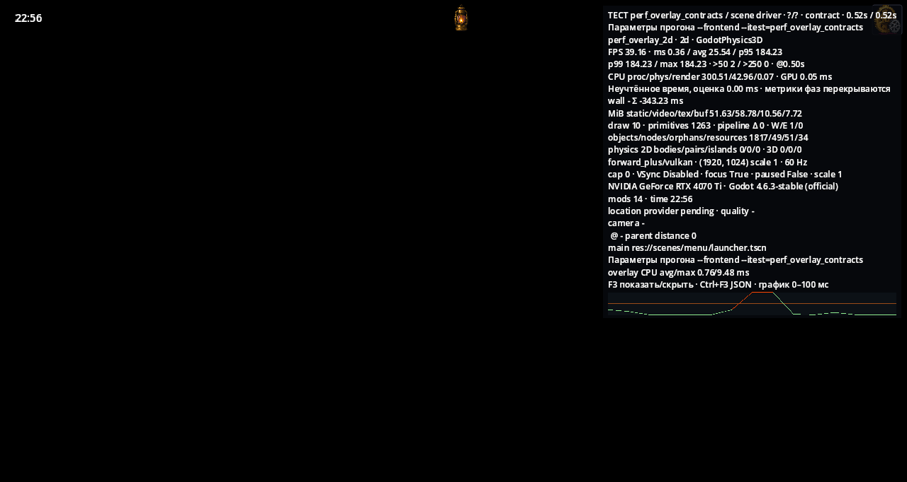
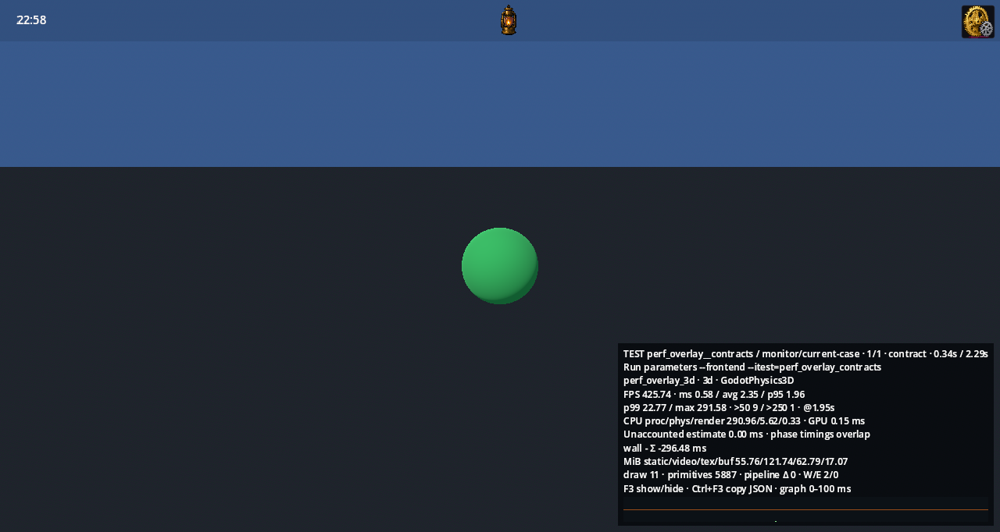

# Resource monitor

Add `perf_overlay` to a collection or use `--with-mods=perf_overlay`. The public module
requires only `ui_base >=0.1.0`; it has no dependency on a 3D subsystem.

Normal play starts with the panel off. F3 toggles it without claiming input or mouse
focus. Settings → Mods → Resource monitor provides visibility, four screen corners,
compact/detailed view and **Copy snapshot**. Ctrl+F3 also copies the current snapshot
as one JSON line to the clipboard and `GameLogger` (`PERF_OVERLAY`). The passive panel
itself never consumes clicks.

The `test_monitor` virtual suite automatically includes the monitor for `--itest=`,
`--run-tests`, dialog autoplay and supported demo/matrix flags. It works even in a
restricted game/frontend collection when the module is present in the physical
project. A custom minimal project copier must include this module too.

The first line identifies the active ModTest through the runner's read-only
`ModTestProgress.Current`: mod, exact attribute ID, index/total, case time and suite
time. Scene drivers without ModTest methods show their itest/scene identity and
explicit unknown method/count (`scene driver`, `?/?`), rather than invented IDs.
Arguments remain in the JSON and detailed display.

## Reading the numbers

Frame samples use actual monotonic wall time. Exact nearest-rank p95/p99/max cover
five seconds; >50 and >250 ms counts last for the monitor session. A fixed 32768-slot
ring bounds memory; exceptionally high FPS overflow is reported as dropped samples.
Text, graph, metadata and optional providers update four times a second. Numeric
frame collection reuses buffers; formatting/JSON allocation is outside that path.

Process/physics monitors, render CPU+setup and GPU time overlap and GPU results may
be delayed. The displayed unaccounted estimate subtracts their maximum from wall
time; JSON additionally includes the requested signed wall-minus-sum residual.
Neither is a direct blocked-thread measurement. GPU milliseconds are not GPU usage
percent. Zero monitor values can mean unsupported/release-only limitations. Video
memory is engine-tracked allocations, not total dedicated VRAM used by the OS.

Detailed mode includes FPS cap, VSync, focus, simulation pause and time scale. These
are observed, never changed. A high wall frame with low CPU/GPU is an investigation
clue; the panel does not label it a confirmed driver, wait or physics defect.
Camera distance is explicitly the camera's local distance from its parent. Logical
location and authored quality may be filled by an optional provider; absence is
shown rather than guessed from a filename. No terrain, navigation or actor clocks
are advanced by this module.

## Optional providers

Implement `IPerfOverlaySection.Collect(PerfOverlaySnapshot)` in a mod depending on
`perf_overlay >=0.1.0`. The existing type-consumer pipeline discovers/retires it.
Use `snapshot.Section("namespace", "visible text")` for extra rows and namespaced
`Values` entries for JSON. Known metadata entries such as `location_id` and `quality`
may be supplied by their actual owner. Keep collection inexpensive; it runs at 4 Hz.

## Capture and lifetime

`ViewportCapture` excludes registered diagnostic CanvasLayers, redraws a clean frame
only when necessary and retains the existing HDR-to-sRGB conversion. An explicit
`includeDiagnostics: true` is for monitor documentation only. With no diagnostic
canvas, the previous capture path performs no additional draw. Generic HUD is never
registered for exclusion.

The shared native-client capture helper leases a PID-scoped local pipe, waits for
one actual clean draw, captures the window and restores the panel. If this optional
mod is absent there is no pipe and normal capture continues. The handshake does not
switch desktops, change HDR/renderer/exposure or claim game input. Independent
capture keeps its existing foreground/occlusion checks.

The node unregisters logging/capture callbacks and joins its cancellation-aware
pipe service during coordinated application exit. Timing is left enabled once
requested, so disabling diagnostics cannot disable another profiler's viewport
measurements.

## Verification

Only the scoped monitor contract exercises its 2D/3D shell transition; no 2D
regression or full suite is requested. Pure statistics and runner metadata tests are
in `tests/Cthangover.Tests/PerfOverlayTests.cs`. Host reproduction:

```powershell
python authoring3d/perf_overlay/run_contract.py --godot <godot.exe> --out <new-absolute-directory>
```

Run it through a PS1 watcher job. Preserve the normal renderer and display mode.

## Reviewed monitor captures





The scoped contract passes its 32 functional checks. Independent desktop bitmap
comparison remains blocked by host foreground refusal; the overall harness result
is FAIL. Steady callback mean/p95/p99 is below 0.2 ms; occasional refresh and startup
peaks exceed that value. This does not establish a hard per-frame budget.
