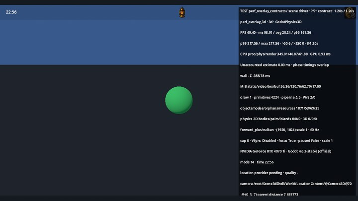

# Resource monitor

Enable the resource monitor in the mod settings to see frame time, FPS and the rendering, process and physics figures available for the current scene. Choose a screen corner. The detailed view adds a frame graph and sections supplied by installed mods. Some renderer counters are unavailable in headless runs.



Use **Copy snapshot** in the settings to capture the scene context and measured values. For comparisons use the same scene, route, graphics preset and resolution. Frame-time percentiles show slow frames that the mean FPS can hide.

With Debug Client connected, collect a clean window without drawing the panel:

```text
run({"provider":"perf_overlay","command":"perf.configure","arguments":{"enabled":true,"overlay":false,"reset":true}})
run({"provider":"perf_overlay","command":"perf.read"})
run({"provider":"perf_overlay","command":"perf.configure","arguments":{"enabled":false}})
```
