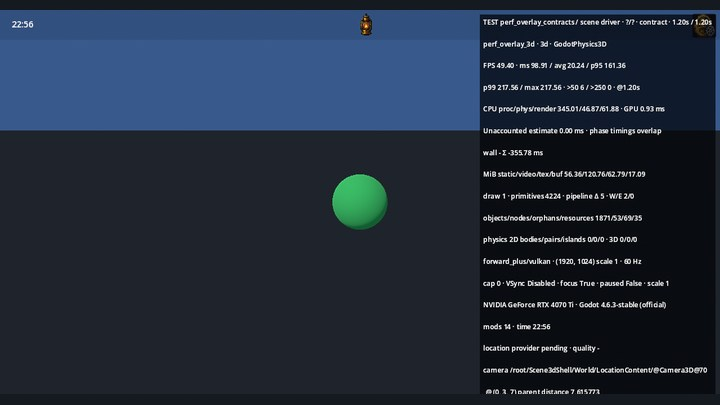

# Монитор ресурсов

Включите монитор в настройках мода, чтобы видеть FPS, время кадра и доступные показатели рендера, процесса и физики текущей сцены. Там же можно выбрать угол экрана. Подробный режим добавляет график кадров и секции подключённых модов. В headless-запуске часть показателей рендера недоступна.



Кнопка **Скопировать снимок** переносит замеры и контекст сцены в буфер обмена. Сравнивайте показатели при одинаковых маршруте, разрешении и графическом пресете. Перцентили времени кадра показывают задержки, которые теряются в среднем FPS.

Через Клиент отладки можно записать выборку без панели на экране:

```text
run({"provider":"perf_overlay","command":"perf.configure","arguments":{"enabled":true,"overlay":false,"reset":true}})
run({"provider":"perf_overlay","command":"perf.read"})
run({"provider":"perf_overlay","command":"perf.configure","arguments":{"enabled":false}})
```
